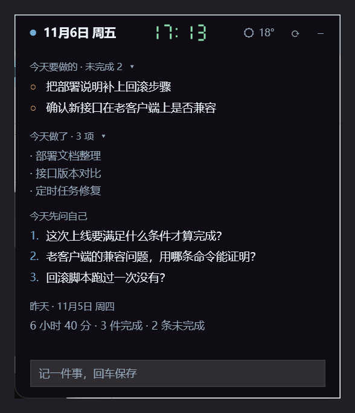

# daily-digest

Claude Code 插件：把每天的会话记录整理成工作日报，并在桌面放一张随时能看的备忘小窗。

## 它做什么

- **每日分析** —— 做了什么、时间花在哪、提问质量如何（每天 08:00 自动跑，04:00 日界）
- **次日追问** —— 新开会话时把昨天没答完的问题带进来
- **桌面小窗** —— 常驻屏幕边缘，显示今天要做的、今天做了哪些、今天该问自己什么
- **归档** —— 日报可上传到百度网盘，或留在本地

## 桌面小窗长这样



贴边吸附 · 3 秒自动隐藏 · `Ctrl+Alt+N` 或说「芝麻开门」唤出 · 七段数码管时钟 · 实时天气 · 待办双击勾选、悬停删除。

（截图里的内容是示例，不是真实工作记录。）

## 安装

```bash
claude plugin marketplace add Xcscv889/daily-digest
claude plugin install daily-digest@local
```

数据目录固定在 `~/.daily-digest/`，插件本身不含任何数据。

## 使用

```
/daily-digest              # 分析昨天（04:00 日界）
/daily-digest 2026-11-04   # 指定日期
/daily-digest week         # 最近一周
```

## 仓库结构

```
.claude-plugin/marketplace.json   插件清单
daily-digest/                     插件本体
├── skills/daily-digest/SKILL.md  分析流程与报告格式
├── hooks/hooks.json              SessionStart 注入
└── scripts/                      采集、归档、桌面小窗
```

配置项、隐私边界、计划任务和编译方法见 **[daily-digest/README.md](daily-digest/README.md)**。

## 要求

- Windows 10/11 + PowerShell 7 + Python 3.9+
- Claude Code CLI 已登录

## License

MIT
