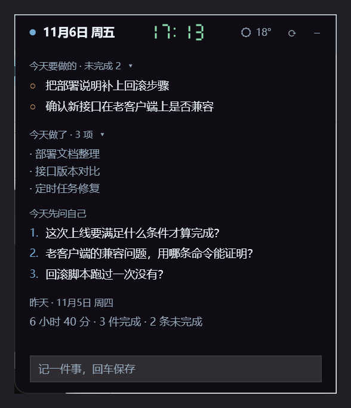

# daily-digest

把 Claude Code 的本地会话记录整理成工作日报，并在桌面放一张随时能看的备忘小窗。

- **每天早上**自动分析前一天：做了什么、时间花在哪、提问质量如何
- **新开会话时**把昨天没答完的问题带进来
- **桌面小窗**常驻屏幕边缘：今天要做的、今天做了哪些、今天该问自己什么
- **归档**到本地或百度网盘（也可换 rclone / Notion / 钉盘）

## 安装

```bash
claude plugin marketplace add Xcscv889/daily-digest
claude plugin install daily-digest@local
```

数据目录固定在 `~/.daily-digest/`，插件本身不含任何数据。

## 使用

```
/daily-digest              # 分析昨天
/daily-digest 2026-11-04   # 指定日期
/daily-digest week         # 最近一周
```

## 仓库结构

```
.claude-plugin/marketplace.json   插件清单
daily-digest/                     插件本体
├── skills/daily-digest/SKILL.md  分析流程、报告格式、证据规则
├── hooks/hooks.json              SessionStart 注入
├── scripts/                      采集、归档、小窗
└── scripts/native/               小窗源码与编译产物
```

## 数据目录

```
~/.daily-digest/
├── config.json          配置：日界、排除项目、归档驱动、天气坐标
├── tasks.md             待办（小窗读写）
├── done.md              完成记录，带日期，供「今天做了」使用
├── today.txt            今日事实清单（改过的文件、最近的提问）
├── today-summary.txt    AI 概括的 3–4 条要点
├── current.md           小窗读的日报摘要视图
├── live.json            今日活跃统计
├── days/*.md            每天的日报，本地保留 7 天
├── weekly/*.md          周报
├── state/next.md        次日追问
├── work/                中间产物，3 天后自动清理
├── memo.json            小窗位置、透明度、各开关状态
└── memo.log / run.log   日志
```

## 配置

```json
{
  "day_boundary": "04:00",
  "keep_local_days": 7,
  "exclude_mode": "content_anonymous",
  "exclude_projects": ["MyCompany-Repo"],
  "archive": { "driver": "local", "local_path": "D:/DailyDigest" },
  "weather": { "city": "南京", "latitude": 32.06, "longitude": 118.80 }
}
```

**日界**：`day_boundary` 决定一天从几点算起。默认 04:00，熬夜到凌晨一点的内容仍算前一天。

**排除项目**：`exclude_mode` 三档。

| 值 | 行为 |
|---|---|
| `full` | 整段跳过，日报里不出现 |
| `stats_only` | 只保留时间 / 报错数，不采集内容 |
| `content_anonymous` | 采集内容，但项目名显示为「已排除项目 · A/B/C」，路径里的仓库名会打码 |

**归档驱动**：`local` / `baidu`（百度网盘 CLI）/ `rclone` / `notion` / `dingtalk` / `shell`。

**天气**：用 [Open-Meteo](https://open-meteo.com/) 免费接口，`weather` 段填你所在城市的经纬度（城市名只是备注）。取不到时显示「天气不可用」，原因写进 `memo.log`。

## 桌面小窗



### 显示什么

```
● 11月6日 周五      17:01    18°   ⟳  –
今天要做的 · 未完成 2  ▾
今天做了 · 4 项  ▾
今天先问自己
昨天 · 11月5日 周四（一行摘要）
[ 记一件事，回车保存 ]
```

- 标题栏：今天的日期、居中的**七段数码管时钟**（可切换成 ASCII 小宠物）、实时天气
- **今天要做的**：来自 `tasks.md` 的未完成项，最多 6 条
- **今天做了**：优先用 AI 把当天会话概括成 3–4 条；没有概括时退回事实列表（改过哪些文件、问过什么）
- **今天先问自己**：昨晚生成、今天该回答的三个问题
- **今日留痕**：`~/career-evidence/daily/` 里今天记下的工作条目，默认折叠
- **昨天**：前一天日报的一行摘要，全文在 `days/*.md`，默认折叠

每个区块标题可点击折叠；「今天做了」可在右键菜单里整段关闭。

### 怎么操作

| 操作 | 效果 |
|---|---|
| 回车 | 保存输入框里的待办 |
| `Ctrl+Enter` | 输入时换行 |
| 双击待办 | 勾选 / 取消勾选（同时记进 `done.md`） |
| 悬停待办右侧 × | 删除这条 |
| 拖动标题栏 | 移动窗口，靠近屏幕边缘 24px 自动吸附 |
| 贴边后鼠标离开 3 秒 | 收起，只在边缘留 12px |
| 扫过那条边 | 滑回来 |
| `Ctrl+Alt+N` | 随时唤出并把光标放进输入框 |
| 说「芝麻开门」 | 语音唤出（Windows 离线识别） |
| 右键任意位置 | 菜单：刷新今天做了 / 显示今天做了 / 显示小宠物 / 语音唤出 / 贴边自动隐藏 / 透明度 / 刷新 / 打开全文 / 退出 |

### 技术细节

- `scripts/native/DailyMemoWpf.exe`：C# WPF 编译版，约 85 MB 内存（PowerShell 版是 270 MB）
- 界面用 XAML 字符串在运行时解析，单文件、无依赖，需要 .NET Framework 4.8（Windows 10/11 自带）
- 不可缩放；误触最大化会自动还原成 360 宽
- 状态只在用户改动时写回 `memo.json`，外部编辑不会被退出覆盖

重新编译（系统自带 csc，无需 .NET SDK）：

```
csc -nologo -target:winexe -optimize+ ^
  -r:"%WINDIR%\Microsoft.NET\assembly\GAC_MSIL\PresentationFramework\v4.0_4.0.0.0__31bf3856ad364e35\PresentationFramework.dll" ^
  -r:"%WINDIR%\Microsoft.NET\assembly\GAC_64\PresentationCore\v4.0_4.0.0.0__31bf3856ad364e35\PresentationCore.dll" ^
  -r:"%WINDIR%\Microsoft.NET\assembly\GAC_MSIL\WindowsBase\v4.0_4.0.0.0__31bf3856ad364e35\WindowsBase.dll" ^
  -r:"%WINDIR%\Microsoft.NET\assembly\GAC_MSIL\System.Xaml\v4.0_4.0.0.0__b77a5c561934e089\System.Xaml.dll" ^
  -r:"%WINDIR%\Microsoft.NET\assembly\GAC_MSIL\System.Speech\v4.0_4.0.0.0__31bf3856ad364e35\System.Speech.dll" ^
  -out:DailyMemoWpf.exe MemoWpf.cs
```

### 关于仓库里的 exe

`scripts/native/DailyMemoWpf.exe` 是编译产物，提交进仓库是为了免去用户自己装编译器。它由同目录的 `MemoWpf.cs` 编译而来，没有任何依赖，也可以自己重新编译后替换。

SHA256（v4.12.0）：

```
72278A6CB71635304FB41194AEAD57D8DE220E73B040568CF9531735829A49C7
```

不想运行现成二进制的话，按上面的命令编译，或改用 `scripts/memo.ps1`（PowerShell 版，功能略旧但代码更好改）。

## 脚本

| 脚本 | 作用 |
|---|---|
| `collect.py` | 只读抽取会话记录 → `day.json` |
| `live.py` | 今日活跃统计，写 `live.json` / `today.txt` |
| `today-summary.ps1` | 调一次 `claude -p`，把今天压成 3–4 条要点 |
| `session-start.ps1` | SessionStart hook 入口，输出 UTF-8 JSON |
| `run-daily.ps1` | 每日任务：补跑缺的天 → 抽取 → 分析 → 归档 → 清理 |
| `run-daily.vbs` / `run-weekly.vbs` | 无控制台启动器，计划任务调这两个 |
| `run-weekly.ps1` | 周报任务 |
| `ensure-memo.ps1` | 小窗守护：不在就拉起 |
| `ensure-memo.vbs` | 守护任务的无控制台启动器，计划任务调这个 |

## 计划任务

| 任务 | 触发 | 作用 |
|---|---|---|
| `ClaudeDailyDigest` | 每天 08:00；登录后 5 分钟补跑 | 生成前一天的日报，并把漏掉的天补上 |
| `ClaudeWeeklyDigest` | 每周日 20:00；登录后 5 分钟补跑 | 汇总周报 |
| `ClaudeMemoWatchdog` | 每 10 分钟 | 小窗没在跑就拉起来 |

**启动方式**：日报和周报任务都通过 `wscript.exe run-daily.vbs` 拉起来，不要在任务里直接调 `pwsh.exe`。两个原因：

1. 任务里写 `pwsh.exe` 别名会 `0x80070002` 失败（Store 版 PowerShell 的别名计划任务解析不到），以前踩过一次
2. 直接调 `pwsh.exe` 会带一个控制台窗口，误关掉就是 `0xC000013A`（2026-11-09 两次日报中断就是这个原因）；vbs 用 `WScript.Shell.Run` 的窗口样式 0 启动，没有窗口可关

**补跑**：`run-daily.ps1` 记 `state/last-run.json` 里的 `last_run_date`，每次从那天之后一路补到昨天，最多补 14 天。0 会话的天只写日志、不调模型；已有 `days/<date>.md` 的天跳过。要重跑某天用 `-Date yyyy-MM-dd`（此时不更新标记）。

## 成本

- 每天 08:00 的日报：一次读一天的会话，约 4–8k token
- 小窗「今天做了」：每小时一次短调用，内容太少时自动跳过
- 其余步骤（采集、归档、清理）不调用模型

## 依赖

- Windows 10/11 + PowerShell 7 + Python 3.9+
- 无头分析需要 `claude` CLI 已登录
- 天气需要能访问 `api.open-meteo.com`（TLS 1.2）

## 隐私

- 只读 `~/.claude/projects/**/*.jsonl`，不截屏、不读浏览器、不扫文件夹
- 日报默认只落本地；配置云盘驱动后，日报正文才会离开本机
- `exclude_projects` 可配置成完全不采集内容；`content_anonymous` 模式下项目名和路径里的仓库名会打码
- 语音识别用 Windows 自带离线引擎，不需要联网

## 排错

| 现象 | 处理 |
|---|---|
| 小窗不见了 | `Get-Process DailyMemoWpf`；不在就等 10 分钟守护，或双击启动项 |
| 小窗藏起来了 | 鼠标扫过屏幕顶部那条 12px，或 `Ctrl+Alt+N`，或说「芝麻开门」 |
| 天气不可用 | 检查 `config.json` 坐标和网络 |
| 日报为空 | 确认当天在非排除项目里有会话 |
| 计划任务失败 | 看 `LastTaskResult`，`0x80070002` 就是 pwsh 路径问题 |

日志：`~/.daily-digest/memo.log`、`run.log`

## License

MIT
